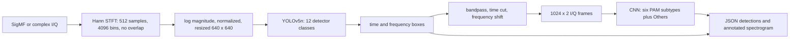

# Wideband Signal Recognition

The synthetic-to-CLI pipeline runs end to end, but the reduced CPU YOLOv5n did not learn useful detections. It processes I/Q through detection, PAM classification, and JSON plus annotated-spectrogram output. Latest measured reduced CPU run: YOLOv5n trained for 135 requested epochs; recall 60.42% (recording-bootstrap CI [47.92%, 70.83%]; 4 recordings / 48 signals) and mAP@0.5 at global SNR >= 5 dB 53.63% (CI [43.68%, 69.52%]; 2 recordings / 24 signals; LOW-SUPPORT). The energy geometry baseline had higher held-out recall (62.50% vs 60.42%; CI [54.17%, 70.83%]; 4 recordings / 48 signals), but this is not a matched-precision comparison (energy precision 60.00%; YOLO precision 82.86%). Validation calibration attained the 80% precision target for YOLO: True; energy baseline: True. PAM all-signal accuracy was 37.50% (uniform seven-class chance: 1/7 = 14.29%; CI [29.17%, 45.83%]; 4 recordings / 48 signals). These are reduced CPU measurements and are not comparable to the full-scale targets; full GPU results remain unmeasured. See [DIAGNOSIS.md](DIAGNOSIS.md) for the training-only bug check and [RESULTS.md](RESULTS.md) for complete results.

## Architecture



A box's horizontal axis is time over the 999,936 samples covered by the 1,953 non-overlapping STFT windows. Its vertical axis is normalized frequency from -0.5 to 0.5 cycles/sample. With a declared sample rate, the CLI converts the coordinates to seconds and hertz.

### Synthetic data and splits

The generator creates one burst per detector class in each 1,000,000-sample recording. The main configuration uses a minimum bandwidth of 0.025 cycles/sample and minimum duration of 100,000 samples. These become about 16 frequency pixels by 64 time pixels at 640 x 640, a deliberate increase over the paper's fine-resolution settings to keep signals visible after resizing. The main layout has no time-frequency overlap and enforces filter guard bands. A shifted test changes bandwidth and SNR ranges.

The configured main split uses parent recording IDs before rendering: 48 train, 12 validation, and 60 main-test recordings, plus 12 separate shifted-test recordings. The main test has 30 recordings at 0.5 dB global SNR and 30 at 15 dB. The recorded split audit and realized support counts are in `results/major_project_cpu/`. All test thresholds are selected on validation only. Confidence intervals resample parent recordings. A result cell with fewer than 30 signals is marked `LOW-SUPPORT`.

Global SNR means `10 log10(total clean signal power / total added noise power)` over the full I/Q recording. The PAM evaluation also records approximate in-band SNR because it can differ substantially from global SNR.

### Reproduce the CPU run

Use Python 3.10 to 3.12. From the project folder, install the pinned CPU stack, run tests, fetch the pinned detector source, and launch the synthetic-only experiment:

```powershell
py -3.12 -m venv .venv
.\.venv\Scripts\Activate.ps1
python -m pip install -r requirements-cpu-run.txt
python -m pytest -q
New-Item -ItemType Directory -Force work | Out-Null
git clone https://github.com/ultralytics/yolov5.git work/yolov5_pinned
git -C work/yolov5_pinned checkout f9578796b8a64889aa9e66dc06914d19f40d338e
$env:PYTHONPATH = 'src'
python scripts/run_milestone2.py --config configs/major_project_cpu.yaml --yolo-dir work/yolov5_pinned --out-dir outputs/major_project_cpu --data-work tmp/major_project_cpu --device cpu --timing-probe --runtime-budget-minutes 40 --evaluation-reserve-minutes 8 --pam-training-budget-minutes 5 --run-label "synthetic-only 12-class major project CPU run"
```

The run writes checkpoints, full training data, logs, and raw intermediate files under ignored `outputs/` and `tmp/` folders. Publishable measured JSON, split audit, summary, and plots are copied to `results/major_project_cpu/`. It will evaluate the latest saved detector checkpoint if the configured time budget interrupts training. Test data must remain frozen when investigating a miss.

### Run the CLI with a trained checkpoint

After the CPU run has created `outputs/major_project_cpu/checkpoints/yolov5n_best.pt` and `pam_cnn.pt`, generate a reproducible 1M-sample SigMF example and run the default YOLO plus PAM path:

```powershell
$env:PYTHONPATH = 'src'
$threshold = (Get-Content results/major_project_cpu/metrics.json -Raw | ConvertFrom-Json).validation_calibration.yolo.threshold
python scripts/generate_synthetic_sigmf.py work/demo_16qam.sigmf-meta --layout pam16qam --seed 2026 --samples 1000000 --global-snr-db 15
python -m wideband_recognition.cli work/demo_16qam.sigmf-meta --detector-weights outputs/major_project_cpu/checkpoints/yolov5n_best.pt --pam-weights outputs/major_project_cpu/checkpoints/pam_cnn.pt --yolo-dir work/yolov5_pinned --image-size 640 --confidence-threshold $threshold --device cpu --output-dir examples/major_project_cpu/16qam
python scripts/generate_synthetic_sigmf.py work/demo_multi.sigmf-meta --layout multi --seed 3030 --samples 1000000 --global-snr-db 15
python -m wideband_recognition.cli work/demo_multi.sigmf-meta --detector-weights outputs/major_project_cpu/checkpoints/yolov5n_best.pt --pam-weights outputs/major_project_cpu/checkpoints/pam_cnn.pt --yolo-dir work/yolov5_pinned --image-size 640 --confidence-threshold $threshold --device cpu --output-dir examples/major_project_cpu/multi
```

The CLI reads samples from the SigMF file; it does not regenerate deployment input from the seed. Example JSON and annotated PNGs are committed under `examples/` when generated. Model weights and raw IQ files are excluded from Git.

## Acceptance results

The table above is generated from the recorded run. `met` and `missed` compare the measured point estimate with the target; confidence intervals and support are shown alongside it. A score from a small synthetic run does not establish real-world performance. The full GPU run and evaluation on external recordings remain not measured.

Detailed per-class and per-SNR results, confidence intervals, supports, confusion matrices, plots, and split IDs are in [RESULTS.md](RESULTS.md) and [`results/major_project_cpu/`](results/major_project_cpu/). Training-only bug checks and interpretation are in [DIAGNOSIS.md](DIAGNOSIS.md).

## Limitations

- The signal generator is synthetic and simplified. It produces approximate modulated waveforms, not verified standards-compliant transmitters.
- No DeepSig or Zenodo files have been downloaded or used. Zenodo's record-level Rights field is unverified; no license claim is made for those files. See [LICENSES.md](LICENSES.md).
- The generator does not model APSK subtypes for the second-stage classifier. The PAM detector label merges the six generated PSK/QAM schemes; the classifier's `Others` label contains non-PAM interference classes.
- The main layout has no time-frequency overlap. Overlap, multipath fading, residual carrier offset beyond extraction error, oscillator phase noise, IQ imbalance, DC offset, nonlinear hardware distortion, ADC quantization, AGC behavior, and sample-clock drift are not modeled.
- The synthetic shifted test is not a substitute for measurements on a radio receiver or an independently collected dataset.
- The 640-pixel image and raised minimum signal dimensions trade fine resolution for learnability and are deviations from the paper configuration.
- The energy detector is a class-agnostic geometry baseline. It cannot identify modulation and does not gate YOLO labels.
- OOK versus narrow AM-DSB and FM versus PAM confusion are expected ambiguities to monitor.
- Weights are not stored in Git. Regenerate them with the pinned CPU command or provide your own compatible checkpoints.

## Project notes

- [EXPLAINER.md](EXPLAINER.md): plain-language interview guide.
- [SPEC.md](SPEC.md): scope and measurable acceptance criteria.
- [DECISIONS.md](DECISIONS.md): design decisions and reasons.
- [LICENSES.md](LICENSES.md): project and dependency/data license notes.


## Automated Reduced-CPU Workflow Status
<!-- REDUCED_CPU_RESULTS_START -->

**Run:** reduced run: CPU, small data, not comparable to target. Performance target status is not comparable due to reduced support. The full GPU run via the optional Colab notebook is still unmeasured.

| Acceptance metric | Target | Reduced CPU measured | 95% recording-bootstrap CI | Support | Status |
|---|---:|---:|---:|---|---|
| Detector recall, global SNR >= 5 dB | >= 80% | 66.67% | [58.33%, 75.00%] | 2 recordings / 24 signals; LOW-SUPPORT | not comparable |
| Mean IoU, global SNR >= 5 dB | >= 75% | 86.17% | [84.65%, 87.34%] | 2 recordings / 24 signals; LOW-SUPPORT | not comparable |
| Class mAP@0.5, global SNR >= 5 dB | >= 60% | 53.63% | [43.68%, 69.52%] | 2 recordings / 24 signals; LOW-SUPPORT | not comparable |
| PAM oracle accuracy (chance 1/7 = 14.29%), global SNR >= 10 dB | >= 80% | 50.00% | [0.00%, 100.00%] | 2 recordings / 2 signals; LOW-SUPPORT | not comparable |
| PAM oracle accuracy (chance 1/7 = 14.29%), global SNR [0, 1) dB | > 50% | 0.00% | [0.00%, 0.00%] | 1 recordings / 1 signals; LOW-SUPPORT | not comparable |
| Owner's local processing time per 1M samples | < 5 seconds | not measured | not applicable | owner measurement pending | not comparable |

Main test support: 4 recordings / 4 segments; shifted test: 4 recordings / 4 segments.

See [RESULTS.md](RESULTS.md), [the measured metrics JSON](results/reduced_cpu/metrics.json), and [the recording split audit](results/reduced_cpu/split_audit.json) for per-class/per-SNR CIs, support, confusion matrices, split IDs, and plots. Cells under 30 signals are LOW-SUPPORT.
<!-- REDUCED_CPU_RESULTS_END -->

