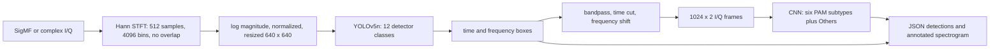

# Wideband Signal Recognition

A self-contained B.Tech major-project prototype for spectrum monitoring. It converts complex I/Q data into time-frequency boxes and modulation labels using a two-stage detector and I/Q classifier. All current training and evaluation data are generated locally with recorded seeds. The former 53.55 GiB DeepSig/Zenodo download requirement has been dropped; external recordings are not downloaded or used. No score from Vagollari et al. is presented as a project result.

Reference architecture: Vagollari, Hirschbeck, and Gerstacker, “An End-to-End Deep Learning Framework for Wideband Signal Recognition,” IEEE Access, 2023. This repository uses a smaller synthetic CPU benchmark and does not claim to reproduce the paper's training scale or measured performance.

The active model taxonomy is the paper's 12 detector labels (`AM-DSB`, `AM-SSB`, `FM`, `PAM`, `OFDM`, `2-FSK`, `2-CPFSK`, `4-FSK`, `4-CPFSK`, `OOK`, `GMSK1`, `GMSK2`) and a seven-label I/Q classifier (`2-PSK`, `4-PSK`, `8-PSK`, `16-QAM`, `64-QAM`, `256-QAM`, `Others`). The generator uses controlled synthetic waveforms and wideband AWGN; it is an educational approximation, not a standards-conformance or real-radio validation suite.

**Measured status:** the code runs through dataset generation, YOLO training/evaluation, PAM classification, extraction and SigMF CLI output. The trained CPU detector missed its recall and mAP targets; the energy geometry baseline had higher overall main-test recall (81.39% versus 56.53%). The IoU target was met, while both PAM oracle-box accuracy targets were missed. The calibrated 16-QAM CLI sample returned zero detections, and the mixed sample returned 11 detections with no PAM label or subtype. Full GPU and external-data results are not measured.

<!-- MAJOR_PROJECT_RESULTS_START -->
**Measured run:** synthetic-only 12-class major project CPU run. Device: cpu. Synthetic data only; no DeepSig or Zenodo recordings were downloaded or used.

| Acceptance target | Threshold | Measured | Recording-level 95% CI | Support | Status |
|---|---:|---:|---:|---|---|
| Detector recall, global SNR >= 5 dB | >= 80% | 63.06% | [59.30%, 66.94%] | 30 recordings / 360 signals | missed |
| Mean IoU, global SNR >= 5 dB | >= 0.75 | 87.89% | [87.18%, 88.68%] | 30 recordings / 360 signals | met |
| Class mAP@0.5, global SNR >= 5 dB | >= 60% | 41.27% | [40.95%, 45.11%] | 30 recordings / 360 signals | missed |
| PAM oracle-box accuracy, global SNR >= 10 dB (chance 1/7 = 14.29%) | >= 80% | 46.67% | [30.00%, 63.33%] | 30 recordings / 30 signals | missed |
| PAM oracle-box accuracy, global SNR [0, 1) dB (chance 1/7 = 14.29%) | > 50% | 36.67% | [20.00%, 53.33%] | 30 recordings / 30 signals | missed |
| Local processing time per 1M-sample segment | < 5 seconds | 29.891 s | not applicable | Maximum measured CLI internal wall time across two local CPU synthetic SigMF examples; includes input read, spectrogram, YOLO, extraction/classification, and annotated PNG write; excludes JSON serialization. | missed |

Detector training: completed (80 completed / 80 requested epochs). PAM training: completed (42 completed / 60 requested epochs).
Measured full pipeline runtime: 2477.0320000000065 seconds; data generation: 322.6992998000351 seconds.
The target statuses use measured point estimates. CIs and recording/signal support are shown for uncertainty; any cell below 30 signals is low-support.
CLI smoke examples (not acceptance metrics; validation-selected threshold): single_16qam: 0 boxes, 0 PAM boxes, 0 subtype outputs; mixed_12_signal: 11 boxes, 0 PAM boxes, 0 subtype outputs.
<!-- MAJOR_PROJECT_RESULTS_END -->

## Project overview and reproduction

### Problem statement

Wideband monitoring needs to identify which narrowband transmissions occupy a recording, when they occur, where they sit in frequency, and what modulation family they use. This repository is a self-contained, reproducible synthetic SigMF implementation for studying that task under CPU and disk constraints. It is a scaled academic reproduction, not a reproduction of the paper's reported performance or a substitute for measured over-the-air data.

### Two-stage architecture

1. **Stage 1, detection and family classification.** A YOLOv5n detector receives a normalized spectrogram and predicts time-frequency boxes and one of 12 labels: AM-DSB, AM-SSB, FM, PAM, OFDM, 2-FSK, 2-CPFSK, 4-FSK, 4-CPFSK, OOK, GMSK1, or GMSK2. PSK/QAM/APSK-like signals share the visually ambiguous PAM detector label.
2. **Stage 2, PAM subtype classification.** For PAM detections, box coordinates define a time/frequency extraction. The pipeline bandpass-filters the input I/Q, cuts the burst, downconverts to baseband, forms 1024-by-2 I/Q frames, and classifies 2-PSK, 4-PSK, 8-PSK, 16-QAM, 64-QAM, 256-QAM, or Others. The CLI reads the supplied SigMF samples; it does not need training seeds.

### Repository map

- configs/: reproducible run profiles.
- src/wideband_recognition/: signal, spectrogram, detection, extraction, classifier, evaluation, and CLI code.
- scripts/: dataset generation, training/evaluation orchestration, and result publishing.
- tests/: physics, mapping, extraction, and pipeline checks.
- notebooks/: optional Colab workflow.
- results/: measured metrics, split audit, plots, and diagnostic overlays.
- examples/: committed CLI JSON and annotated spectrogram outputs.
- outputs/ and work/: local run products and scratch input; model weights and raw I/Q are excluded from Git.

### Run the CLI

From the repository root, after generating the synthetic SigMF input and creating checkpoints with the documented CPU run, use:

~~~powershell
$threshold = (Get-Content results/major_project_cpu/metrics.json -Raw | ConvertFrom-Json).validation_calibration.yolo.threshold
python scripts/generate_synthetic_sigmf.py work/demo_16qam.sigmf-meta --layout pam16qam --seed 2026 --samples 1000000 --global-snr-db 15
python -m wideband_recognition.cli work/demo_16qam.sigmf-meta --detector-weights outputs/major_project_cpu/checkpoints/yolov5n_best.pt --pam-weights outputs/major_project_cpu/checkpoints/pam_cnn.pt --yolo-dir work/yolov5_pinned --image-size 640 --confidence-threshold $threshold --device cpu --output-dir examples/my_run
~~~

The output directory receives a JSON detection list and an annotated spectrogram PNG. The existing Run the CLI with a trained checkpoint section below includes the multi-signal example and committed run outputs.

### Measured reduced-CPU results

**Label: reduced run: CPU, small data, not comparable to target.** On the frozen recording-disjoint synthetic evaluation, detector recall at global SNR >= 5 dB was 63.06% (95% recording-bootstrap CI 59.30%-66.94%; 30 recordings / 360 signals), mean IoU was 0.8789 (CI 0.8718-0.8868; same support), and class mAP@0.5 was 41.27% (CI 40.95%-45.11%; same support). PAM oracle-box accuracy was 46.67% at >=10 dB (CI 30.00%-63.33%; 30 recordings / 30 signals) and 36.67% at 0-1 dB (CI 20.00%-53.33%; 30 / 30); chance for seven classes is 14.29%. The maximum of the two measured local CLI segment times was 29.891 seconds per 1M samples. The energy baseline had 81.39% overall main-test recall versus 56.53% for YOLO. These measured results miss the stated recall, mAP, PAM accuracy, and speed targets; the IoU target was met. Full-scale GPU results remain not yet measured.

See [RESULTS.md](RESULTS.md) for the complete per-class and per-SNR results, intervals, support counts, and target status; [DIAGNOSIS.md](DIAGNOSIS.md) for the failure analysis; [machine-readable metrics](results/major_project_cpu/metrics.json); and the committed [16-QAM CLI output](examples/major_project_cpu/16qam/) and [multi-signal CLI output](examples/major_project_cpu/multi/). The automated reduced-CPU publisher uses the exact REDUCED_CPU_RESULTS_START and REDUCED_CPU_RESULTS_END markers in this README.
## Architecture



A box's horizontal axis is time over the 999,936 samples covered by the 1,953 non-overlapping STFT windows. Its vertical axis is normalized frequency from -0.5 to 0.5 cycles/sample. With a declared sample rate, the CLI converts the coordinates to seconds and hertz.

### Synthetic data and splits

The generator creates one burst per detector class in each 1,000,000-sample recording. The main configuration uses a minimum bandwidth of 0.025 cycles/sample and minimum duration of 100,000 samples. These become about 16 frequency pixels by 64 time pixels at 640 x 640, a deliberate increase over the paper's fine-resolution settings to keep signals visible after resizing. The main layout has no time-frequency overlap and enforces filter guard bands. A shifted test changes bandwidth and SNR ranges.

The configured main split uses parent recording IDs before rendering: 48 train, 12 validation, and 60 main-test recordings, plus 12 separate shifted-test recordings. The main test has 30 recordings at 0.5 dB global SNR and 30 at 15 dB. The recorded split audit and realized support counts are in `results/major_project_cpu/`. All test thresholds are selected on validation only. Confidence intervals resample parent recordings. A result cell with fewer than 30 signals is marked `LOW-SUPPORT`.

Global SNR means `10 log10(total clean signal power / total added noise power)` over the full I/Q recording. The PAM evaluation also records approximate in-band SNR because it can differ substantially from global SNR.

### Reproduce the CPU run

Use Python 3.10 to 3.12. From the project folder, install the pinned CPU stack, run tests, fetch the pinned detector source, and launch the synthetic-only experiment:

```powershell
py -3.12 -m venv .venv
.\.venv\Scripts\Activate.ps1
python -m pip install -r requirements-cpu-run.txt
python -m pytest -q
New-Item -ItemType Directory -Force work | Out-Null
git clone https://github.com/ultralytics/yolov5.git work/yolov5_pinned
git -C work/yolov5_pinned checkout f9578796b8a64889aa9e66dc06914d19f40d338e
$env:PYTHONPATH = 'src'
python scripts/run_milestone2.py --config configs/major_project_cpu.yaml --yolo-dir work/yolov5_pinned --out-dir outputs/major_project_cpu --data-work tmp/major_project_cpu --device cpu --timing-probe --runtime-budget-minutes 40 --evaluation-reserve-minutes 8 --pam-training-budget-minutes 5 --run-label "synthetic-only 12-class major project CPU run"
```

The run writes checkpoints, full training data, logs, and raw intermediate files under ignored `outputs/` and `tmp/` folders. Publishable measured JSON, split audit, summary, and plots are copied to `results/major_project_cpu/`. It will evaluate the latest saved detector checkpoint if the configured time budget interrupts training. Test data must remain frozen when investigating a miss.

### Run the CLI with a trained checkpoint

After the CPU run has created `outputs/major_project_cpu/checkpoints/yolov5n_best.pt` and `pam_cnn.pt`, generate a reproducible 1M-sample SigMF example and run the default YOLO plus PAM path:

```powershell
$env:PYTHONPATH = 'src'
$threshold = (Get-Content results/major_project_cpu/metrics.json -Raw | ConvertFrom-Json).validation_calibration.yolo.threshold
python scripts/generate_synthetic_sigmf.py work/demo_16qam.sigmf-meta --layout pam16qam --seed 2026 --samples 1000000 --global-snr-db 15
python -m wideband_recognition.cli work/demo_16qam.sigmf-meta --detector-weights outputs/major_project_cpu/checkpoints/yolov5n_best.pt --pam-weights outputs/major_project_cpu/checkpoints/pam_cnn.pt --yolo-dir work/yolov5_pinned --image-size 640 --confidence-threshold $threshold --device cpu --output-dir examples/major_project_cpu/16qam
python scripts/generate_synthetic_sigmf.py work/demo_multi.sigmf-meta --layout multi --seed 3030 --samples 1000000 --global-snr-db 15
python -m wideband_recognition.cli work/demo_multi.sigmf-meta --detector-weights outputs/major_project_cpu/checkpoints/yolov5n_best.pt --pam-weights outputs/major_project_cpu/checkpoints/pam_cnn.pt --yolo-dir work/yolov5_pinned --image-size 640 --confidence-threshold $threshold --device cpu --output-dir examples/major_project_cpu/multi
```

The CLI reads samples from the SigMF file; it does not regenerate deployment input from the seed. Example JSON and annotated PNGs are committed under `examples/` when generated. Model weights and raw IQ files are excluded from Git.

## Acceptance results

The table above is generated from the recorded run. `met` and `missed` compare the measured point estimate with the target; confidence intervals and support are shown alongside it. A score from a small synthetic run does not establish real-world performance. The full GPU run and evaluation on external recordings remain not measured.

Detailed per-class and per-SNR results, confidence intervals, supports, confusion matrices, plots, and split IDs are in [RESULTS.md](RESULTS.md) and [`results/major_project_cpu/`](results/major_project_cpu/). Training-only bug checks and interpretation are in [DIAGNOSIS.md](DIAGNOSIS.md).

## Limitations

- The signal generator is synthetic and simplified. It produces approximate modulated waveforms, not verified standards-compliant transmitters.
- No DeepSig or Zenodo files have been downloaded or used. Zenodo's record-level Rights field is unverified; no license claim is made for those files. See [LICENSES.md](LICENSES.md).
- The generator does not model APSK subtypes for the second-stage classifier. The PAM detector label merges the six generated PSK/QAM schemes; the classifier's `Others` label contains non-PAM interference classes.
- The main layout has no time-frequency overlap. Overlap, multipath fading, residual carrier offset beyond extraction error, oscillator phase noise, IQ imbalance, DC offset, nonlinear hardware distortion, ADC quantization, AGC behavior, and sample-clock drift are not modeled.
- The synthetic shifted test is not a substitute for measurements on a radio receiver or an independently collected dataset.
- The 640-pixel image and raised minimum signal dimensions trade fine resolution for learnability and are deviations from the paper configuration.
- The energy detector is a class-agnostic geometry baseline. It cannot identify modulation and does not gate YOLO labels.
- OOK versus narrow AM-DSB and FM versus PAM confusion are expected ambiguities to monitor.
- Weights are not stored in Git. Regenerate them with the pinned CPU command or provide your own compatible checkpoints.

## Project notes

- [EXPLAINER.md](EXPLAINER.md): plain-language interview guide.
- [SPEC.md](SPEC.md): scope and measurable acceptance criteria.
- [DECISIONS.md](DECISIONS.md): design decisions and reasons.
- [LICENSES.md](LICENSES.md): project and dependency/data license notes.


## Automated Reduced-CPU Workflow Status
<!-- REDUCED_CPU_RESULTS_START -->
<!-- REDUCED_CPU_RESULTS_END -->

